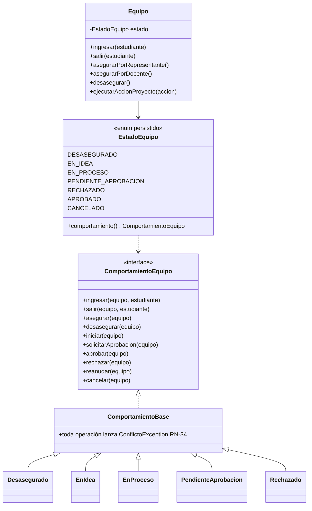

# 10 — Patrones de diseño aplicados

> Para estudiar: repositorio `BE-EXAMPLE-design-patterns-main`, carpetas `state/` y `adapter/` (cada una con su README y un ejemplo ejecutable). Los resúmenes de la cursada no cubren patrones.
> Criterio del equipo: un patrón solo entra si resuelve un problema real. Se aplican **dos**.

## 1. State — estados del `Equipo`
**Problema.** El equipo tiene 7 estados (`DESASEGURADO`, `EN_IDEA`, `EN_PROCESO`, `PENDIENTE_APROBACION`, `RECHAZADO`, `APROBADO`, `CANCELADO`) y cada operación (ingresar, salir, rechazar ingresos, asegurar, desasegurar, iniciar, solicitar aprobación, aprobar, rechazar, reanudar, cancelar) está permitida solo en algunos. Con `if/switch` por estado, esa lógica se repetiría en cada método del `service` y cada estado nuevo obligaría a tocar todos.

**Diseño.**

- Se **persiste solo el enum** (`estado`). Cada valor del enum entrega su objeto de comportamiento (sin estado propio, reutilizable).
- La clase base rechaza todo por defecto (409, RN-34); cada estado concreto **sobrescribe únicamente lo que permite** y cambia el estado del equipo. `Aprobado` y `Cancelado` no permiten nada.
- La regla de *quién* puede (docente/representante, RN10) y las condiciones de cupo viven en el `service`; el estado solo decide **si la transición es válida**.
- Los estados se prueban con unitarios puros (08).

**Por qué no en `Entrega` ni `Snapshot`.** `Entrega` tiene dos estados persistidos y una sola restricción (corregir solo si `ENTREGADA`): un enum y un método de guarda alcanzan. En `Snapshot` los estados son datos del resultado, no cambian el comportamiento. Aplicar State ahí sería sobreingeniería.

## 2. Adapter — acceso a otros servicios y sistemas externos
**Problema.** Los servicios hablan con sistemas que no controlamos (Drive, GitHub, Keycloak) y con otros servicios nuestros, cada uno con su formato, autenticación, paginación y errores. Si el `service` los usara directo, las reglas de negocio quedarían atadas a esos detalles y no se podrían testear sin red.

**Diseño.** El `service` depende de una **interfaz propia** en `client/`; una implementación con `RestClient` adapta el contrato externo al modelo del servicio.

| Interfaz | Servicio | Adapta | Esconde |
|---|---|---|---|
| `CatedraClient` | `ms-documentacion`, `ms-seguimiento` | API interna de `ms-catedra` | URLs, JWT propagado, correlation-id |
| `DocumentacionClient` | `ms-seguimiento` | API interna de `ms-documentacion` | ídem |
| `DriveClient` | `ms-documentacion` | Google Drive API v3 | API key, parseo del enlace, `modifiedTime`, mime types |
| `GitHubClient` | `ms-seguimiento` | GitHub REST | Token, **paginación** de commits, detección de merges, usuario del autor |
| `KeycloakAdminClient` | `ms-catedra` | Keycloak Admin API | Token de servicio, crear/deshabilitar usuario, asignar rol |

Beneficios concretos: (1) los DTO externos (`dto/externo/`) no entran al dominio; (2) la traducción de errores a `NoEncontradoException` / `ServicioNoDisponibleException` está en un único lugar; (3) los `service` se testean con Mockito sin red; (4) si cambia la API externa, se toca una clase.

## Patrones considerados y descartados
| Patrón | Por qué no |
|---|---|
| Iterator | La paginación de GitHub se resuelve con un bucle dentro de `GitHubClient`; un `Iterator` propio no simplifica nada |
| Observer | La comunicación es síncrona y no hay notificaciones (fuera de alcance) |
| Strategy | No hay familias de algoritmos intercambiables en tiempo de ejecución |
| Singleton | Ya lo provee el contenedor de Spring (scope `singleton`, Apunte 15); implementarlo a mano sería ruido |
| Builder | Lo da Lombok (`@Builder`) en entidades; no se diseña uno propio |

## Principios que sostienen el diseño
Separación de responsabilidades (capas), inversión de dependencias (el `service` depende de interfaces `client`), abierto/cerrado (nuevo estado = nueva clase), un solo motivo de cambio por clase.
